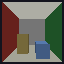

# tiny-rt

A minimal ray-tracing accelerator in Verilog, built to learn how BVH traversal and intersection work in hardware. Inspired by [tiny-gpu](https://github.com/adam-maj/tiny-gpu), tiny-rt follows a similar project layout; all code here is original. It trades performance and generality for a small, readable implementation and a working simulation.


# Overview

A shader core can generate rays and shade their results. The fixed-function RT unit does the repetitive geometric work: walk a bounding volume hierarchy (BVH), test boxes and triangles, and return the closest triangle ID. In this project Python plays the host and shader: it builds the BVH, generates camera rays, and shades the IDs. The hardware does traversal and intersection. No GPU or graphics API is required.

<p>
  
  
</p>

Left: host-shaded scene. Right: false colors assigned to the triangle IDs returned by hardware.

The scene test renders a small Cornell-box-like room at 64 × 64 pixels. With two cores, it completes in 1,040,481 cycles with 3,600 hits out of 4,096 rays; the 8 × 8 triangle test takes 1,395 cycles with 8 hits. The colors and flat Lambert shading are applied by Python, after the hardware returns its results.

# Architecture

- **DCR** holds the 16-bit ray count. Write it before launch.
- **Dispatch** gives one ray index at a time to an idle core and asserts `done` after all writes finish. Reset before another launch.
- **Cores** load a ray, start traversal, and write one result. The default is two cores.
- **Controllers** arbitrate core requests onto external scene-read and framebuffer-write channels. Priority rotates after accepted transfers, and stalled channel assignments remain reserved until ready. The test memory responds combinationally; a slower memory may hold ready low. Channel 0 occupies the least significant packed slice.
- **Traversal** uses a 16-entry stack for deferred right children. The builder must produce a tree that fits; stack overflow is not reported.
- **Box and triangle tests** are combinational fixed-point datapaths. They favor readability over area and timing.

Parameters on `rt` select core count, address widths and channel counts. The data buses and arithmetic are 32 bits; the data-width parameters must remain 32. The default address widths are 16 bits. There is no cache, pipelining, or simultaneous launches.

## How a ray is traced

The host writes the ray count, pulses `start`, and waits for `done`. Each core loads nine words of ray data, then the traversal FSM proceeds as follows:

1. `NODE`: read eight words for the current node.
2. `BOX`: test its bounds. On a miss, go to `NEXT`. On an internal hit, push the right child and visit the left child. On a leaf hit, begin reading its triangles.
3. `TRI`: read nine words of one triangle.
4. `TEST`: update the closest result if this triangle is closer; repeat for the remaining leaf triangles.
5. `NEXT`: pop a deferred node, or finish when the stack is empty.
6. `FINISH`: return the ID to the core, which writes it to framebuffer memory.

Traversal does not prune nodes using the current best distance. Ties retain the first triangle encountered, so traversal order is part of the result.

## Intersection math

Coordinates, directions and inverse directions are signed Q16.16. The host clamps inverse directions to signed 32-bit range and the box unit handles an exactly zero direction separately. The slab test computes `(bound - origin) * inv_dir >> 16`, intersects the three intervals with `[0, infinity)`, and accepts boundary contact. A clamped inverse direction is an approximation; choose rays and bounds accordingly.

The triangle unit uses Möller–Trumbore without division. Each multiplication in a cross or dot product is shifted right by 16 **before** summation, including for negative values; arithmetic right shift rounds toward negative infinity. For edge vectors `e1`, `e2`, ray direction `d`, and `s = origin - v0`:

```text
p = d cross e2              det = e1 dot p
u = s dot p                 q = s cross e1
v = d dot q                 t = e2 dot q
if det < 0: negate det, u, v, t
hit = det > 0 and u >= 0 and v >= 0 and u + v <= det and t > 0
closer = t * best_det < best_t * det
```

The shifted products and sums use signed 64-bit intermediates; closest-hit cross products use 128 bits. With vertex and origin coordinates within ±8, normalized direction components within ±1, and signed 32-bit inverse directions, these intermediates have ample range. The Python reference performs the same individual shifts and comparison. This is fixed-point geometry, not a promise of agreement with floating-point intersection at edges or nearly parallel triangles.

# Memory layout

Addresses are **32-bit word** indices, not byte addresses. All signed numbers are two's-complement words. The default 16-bit address space has fixed bases:

| Region | Base | Contents |
| --- | ---: | --- |
| Rays | 0 | Per ray: origin xyz, direction xyz, inverse direction xyz (9 words) |
| BVH nodes | 40960 | Per node: min xyz, max xyz, left-or-first, count (8 words) |
| Triangles | 49152 | Per triangle: v0 xyz, v1 xyz, v2 xyz (9 words) |
| Framebuffer | 0 | One word per ray: reordered triangle ID, or `0xffffffff` for a miss |

Node 0 is the root. `count == 0` means an internal node with children `left` and `left + 1`. A nonzero count means a leaf containing triangles `[first, first + count)`. The Python builder reorders triangles into contiguous leaves and supplies a map back to the original material IDs. The ray region fits at most 4551 rays without overlapping nodes; all regions must fit their configured address width. Geometry and tree contents are trusted inputs.

# Simulation

Install Icarus Verilog and [sv2v](https://github.com/zachjs/sv2v), then create a Python environment with cocotb:

```sh
python3 -m venv .venv
source .venv/bin/activate
pip install -r requirements.txt
make test_triangle
make test_scene
```

The Makefile converts the SystemVerilog with sv2v and runs Icarus with cocotb. cocotb 1.9.2 may require a compatible Python and compiler combination. The tests compare every framebuffer word with the integer Python model. They log per-cycle core/traversal states in `test/logs/`; the scene test also writes `docs/images/render.png` and `docs/images/render_ids.png`.

# Next steps

- Prune BVH nodes using the current closest distance and traverse nearer children first.
- Add stack overflow detection, fair arbitration, caches and pipelined arithmetic.
- Generate rays in hardware and support more flexible scene layouts.
- Integrate with tiny-gpu using a `TRACE` instruction and shader-side shading.
