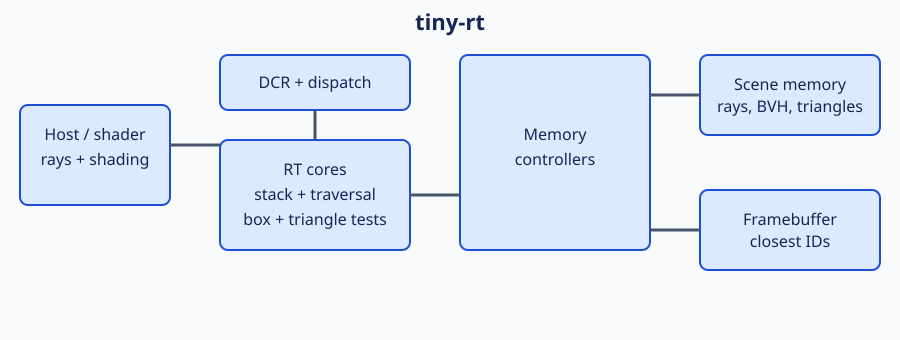

# tiny-rt

A minimal ray tracing unit in Verilog, built to learn how RT cores work from the ground up.

Built with 9 small, fully commented SystemVerilog modules, a bit-exact Python reference model, and a working simulation that renders an image.

Inspired by [tiny-gpu](https://github.com/adam-maj/tiny-gpu). tiny-rt follows a similar project layout. All code here is original.

<p float="left">
  
  
</p>

*Left: the final image. Right: the raw triangle IDs returned by the hardware.*

### Table of Contents

- [Overview](#overview)
- [Architecture](#architecture)
- [How a Ray is Traced](#how-a-ray-is-traced)
- [Intersection Math](#intersection-math)
- [Memory Layout](#memory-layout)
- [Simulation](#simulation)
- [Next Steps](#next-steps)

# Overview

Modern GPUs have dedicated hardware for ray tracing.

NVIDIA calls it the RT core.

How it works inside is not public.

Ray tracing asks one question over and over: **which triangle does this ray hit first?**

A scene has many triangles. Testing all of them for every ray is far too slow.

So scenes are stored in a **BVH** (bounding volume hierarchy). It is a tree of boxes. If a ray misses a box, everything inside it can be skipped.

An RT unit does three things very fast:

1. **Walk the BVH** - decide which box to visit next
2. **Ray-box test** - does the ray pass through this box?
3. **Ray-triangle test** - does the ray hit this triangle, and how far away?

Everything else stays on the shader cores. They create the rays and color the results.

In tiny-rt, Python plays the shader cores. The Verilog plays the RT unit.

```
shader (Python)                   RT unit (Verilog)
───────────────                   ─────────────────
create rays     ───────────────▶  walk BVH
                                  ray-box tests
                                  ray-triangle tests
shade pixels    ◀───────────────  "ray 17 hit triangle 5"
```

# Architecture



To launch a job:

1. Load rays, BVH nodes and triangles into scene memory
2. Write the number of rays to the device control register
3. Set `start` high and wait for `done`
4. Read one triangle ID per ray from framebuffer memory

The unit consists of:

- **Device control register** - stores the ray count.
- **Dispatcher** - hands the next ray index to an idle core.
- **Cores** - each core traces one ray at a time. The default is 2 cores.
- **Memory controllers** - share limited memory channels between the cores, in round-robin order.
- **Traversal** - the BVH walking state machine, with a 16-entry stack.
- **Box test / triangle test** - the intersection math.

There is no cache and no pipelining. Each part is kept simple to read.

# How a Ray is Traced

Each core first loads its ray. Then the traversal state machine runs:

1. `NODE` - read the current BVH node.
2. `BOX` - test the ray against the node's box.
   - Miss: go to `NEXT`.
   - Hit an inner node: push the right child, visit the left child.
   - Hit a leaf: start reading its triangles.
3. `TRI` - read one triangle.
4. `TEST` - keep it if it is the closest hit so far. Repeat for each triangle in the leaf.
5. `NEXT` - pop the next node from the stack. If the stack is empty, finish.
6. `FINISH` - write the closest triangle ID to the framebuffer.

# Intersection Math

All numbers are 32-bit fixed point (Q16.16).

### Ray-box test

The slab test. For each axis:

```text
t1 = (box_min - origin) * inv_dir
t2 = (box_max - origin) * inv_dir
```

The ray hits the box if the three `[t1, t2]` ranges overlap in front of the ray.

`inv_dir = 1 / dir` is computed by the host, so the hardware needs no divider.

### Ray-triangle test

Möller–Trumbore, without division:

```text
e1 = v1 - v0        e2 = v2 - v0        s = origin - v0
p  = dir × e2       det = e1 · p
q  = s × e1         u = s · p
v  = dir · q        t = e2 · q

hit    = det > 0 and u >= 0 and v >= 0 and u + v <= det and t > 0
closer = t * best_det < best_t * det
```

`closer` compares `t / det` against the best hit so far. Cross-multiplying avoids the division.

# Memory Layout

Addresses are 32-bit word indices.

| Region | Base | Per entry |
| --- | ---: | --- |
| Rays | 0 | origin xyz, dir xyz, inv_dir xyz (9 words) |
| BVH nodes | 40960 | min xyz, max xyz, left/first, count (8 words) |
| Triangles | 49152 | v0 xyz, v1 xyz, v2 xyz (9 words) |
| Framebuffer | 0 | triangle ID, or `0xffffffff` on miss (1 word) |

For BVH nodes:

- `count == 0` - inner node. Children are `left` and `left + 1`.
- `count > 0` - leaf. Triangles are `first` to `first + count - 1`.

# Simulation

Install [Icarus Verilog](https://github.com/steveicarus/iverilog) and [sv2v](https://github.com/zachjs/sv2v). Then:

```sh
python3 -m venv .venv
source .venv/bin/activate
pip install -r requirements.txt

make test_triangle   # 1 triangle, 8x8 rays
make test_scene      # Cornell-box style room, 64x64 rays
```

Each test checks every pixel against the Python reference model.

`test_scene` takes about a minute. It finishes in 1,040,481 cycles and writes the images above to `docs/images/`.

Per-cycle core states are logged to `test/logs/`.

# Next Steps

- Skip BVH nodes that are farther than the closest hit so far
- Visit the nearer child first
- Generate rays in hardware
- Add a cache and pipeline the math
- Connect to tiny-gpu as a `TRACE` instruction
